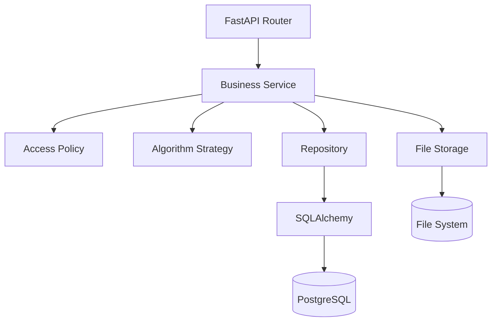

# Architecture

roughapp follows a classical three-layer architecture. Each layer has one
responsibility and depends only on the layer below it:

```text
Presentation Layer   roughapp/api        HTTP: routers, schemas, error mapping
        ↓
Business Logic Layer roughapp/business   services, access policy, algorithms
        ↓
Data Access Layer    roughapp/db         ORM models, repositories, storage, UoW
        ↓
PostgreSQL / SQLite  +  file system (CSV files)
```



The computational core (`roughapp/core/`) sits below all three layers: pure
pandas/NumPy functions for the rough-set primitives, imported by the
algorithm classes and by the test suite, with no dependency on the web
framework or the database.

## Layers

### Presentation — `roughapp/api`

* `routers/` — thin endpoint functions: parse input, call one service
  method, shape the response. No SQLAlchemy queries, no file paths, no
  pandas, no commits.
* `schemas/` — Pydantic request/response models plus the `from_model`
  converters that assemble API fields (e.g. `gamma_before`) from the
  normalized storage (dataset record, `experiment_metrics`, `tree_metrics`).
* `dependencies.py` — the composition root: builds `ActorContext` from the
  JWT user or guest cookie and assembles ONE `ServiceContainer` per request
  (`build_services`), so all services share the same session, repositories
  and unit of work.
* `exception_handlers.py` — the single mapping from business exceptions to
  HTTP status codes (`DatasetNotFoundError → 404`, `ValidationError → 422`,
  `ConflictError → 409`, …).

### Business — `roughapp/business`

* `services/` — user scenarios: `DatasetService` (upload, preview, analyze,
  introduce, complete, delete…), `ExperimentService` (create/run, results,
  export, save-as-dataset), `TreeService` (tree runs, rule
  extraction). Services own the transaction boundary: one scenario, one
  `commit()`; `rollback()` plus file-system compensation on failure.
* `policies.py` — `DatasetAccessPolicy`, the one place deciding who may
  view/modify/delete a resource. Reads of foreign private data fail as
  "not found" so resource ids cannot be probed.
* `ownership.py` — `ActorContext` (user id / guest session id / future team
  memberships), a frozen value object.
* `models/` — `DecisionTable` (validating wrapper around a DataFrame) and
  the structured `DecisionTree` node model.
* `algorithms/` — the algorithm families: each is a package with the pure
  `run()` function modules (the mathematical bodies) plus a `strategies.py`
  wrapping them into classes; `cart.py` is the scikit-learn tree backend.
  Registries live in `algorithms/__init__.py`.
* `runner.py` — `ExperimentRunner`: picks strategies from the registry,
  times them, returns result objects. No SQL, no files, no HTTP.
* `exceptions.py` — domain errors; the business layer never raises
  `HTTPException`.

* `analysis.py` — the inconsistency-analysis scenario (uses `core`);
  `datasets/azad.py` — benchmark table reconstruction;
  `legacy_runner.py` — dict-based runner API kept for the offline batch
  script only.

### Data access — `roughapp/db`

* `models.py` — SQLAlchemy models (also serve as the domain entities; they
  carry derived properties such as `ExperimentResult.gamma_after`).
* `repositories.py` — every query in the application:
  `DatasetRepository`, `ExperimentRepository`, `ReferenceRepository`
  (lookup tables). Repositories never commit.
* `storage.py` — `FileStorage` protocol + `LocalFileStorage`. Services use
  storage keys; only this class knows the directory layout and the
  "record id prefixes the file name" rule.
* `unit_of_work.py` — `UnitOfWork` protocol + SQLAlchemy implementation;
  the commit/rollback handle given to services.
* `engine.py`, `migrations` (alembic/) — session factory and schema
  migrations, applied on startup.

## OOP principles, with the actual examples

* **Encapsulation** — `DecisionTable` validates its invariants (non-empty,
  decision column exists) in the constructor and hides the DataFrame behind
  read-only access; ORM models hide the EAV metric rows behind properties
  (`result.gamma_after`).
* **Abstraction** — `FileStorage` and `UnitOfWork` are Protocols;
  `DatasetAccessPolicy` abstracts "who may do what" away from routers.
  Interfaces exist only where a second implementation is plausible
  (S3 storage, in-memory storage for tests).
* **Inheritance** — the algorithm families: `ResolutionStrategy`,
  `IntroductionStrategy`, `CompletionStrategy`, `TreeBuilder`,
  `RuleExtractor` are ABCs with one concrete class per algorithm.
  Deliberately *separate* interfaces — a resolution strategy and a tree
  builder answer different questions, so there is no universal `Algorithm`.
* **Polymorphism** — `ExperimentRunner.run` executes every selected
  strategy through the same `execute(table)` call; the per-strategy
  if/elif blocks of the old runner are gone.
* **Composition** — services are composed from repositories, policy,
  storage, and unit of work via constructor injection (see
  `api/dependencies.py`).

## SOLID, one example each

* **S** — the datasets router only translates HTTP; `DatasetService.upload`
  only runs the scenario; `DatasetRepository` only queries; `LocalFileStorage`
  only touches disk.
* **O** — a new resolution strategy is a new class plus one
  `resolution_registry.register(...)` line; the runner, services and
  routers do not change.
* **L** — every `ResolutionStrategy` returns a `ResolutionResult` and is
  interchangeable inside the runner (verified by the polymorphic unit test).
* **I** — five small algorithm interfaces instead of one; storage and UoW
  protocols expose only what services call.
* **D** — services depend on the `FileStorage`/`UnitOfWork` protocols and
  repository signatures, not on SQLAlchemy or the local filesystem; the
  concrete classes are chosen in `api/dependencies.py`.

## Extension points

* **New resolution algorithm**: a `run()` module plus a `ResolutionStrategy`
  subclass in `business/algorithms/resolution/`, one
  `resolution_registry.register(...)` line, and a row in the `strategies`
  lookup table.
* **New tree builder**: subclass `TreeBuilder` (e.g. `Id3TreeBuilder`),
  register it, add a row to `tree_algorithms`.
* **New rule extractor**: subclass `RuleExtractor`, register it.
* **S3 instead of local files**: implement the `FileStorage` protocol and
  swap it in `api/dependencies.py`; no service changes.
* **Teams and roles**: `ActorContext` already carries `team_memberships`;
  add a `team_id` ownership column by migration and new rules in
  `DatasetAccessPolicy` — routers and algorithms stay untouched.
* **New dataset operations**: add methods to `DatasetService`; the policy
  and storage collaborators are already injected.

## Transactions and the file system

PostgreSQL cannot roll back file writes. The convention: write files
first, then commit; if the commit fails, roll back and delete the written
files (see `DatasetService.upload`, `ExperimentService.create`). File
*deletions* happen only after a successful commit and are best-effort —
the database row is the source of truth.

## Tests

* `tests/unit/` — no database: `DecisionTable` invariants, access policy
  for user/guest/builtin, registries, every strategy class, the runner,
  tree building and rule extraction.
* `tests/api/` — characterization tests over the full HTTP surface with a
  temporary SQLite database; they pinned the behavior before the layering
  refactor and guard backward compatibility after it.
* `tests/` (top level) — the original algorithm tests against the worked
  example from the thesis.
